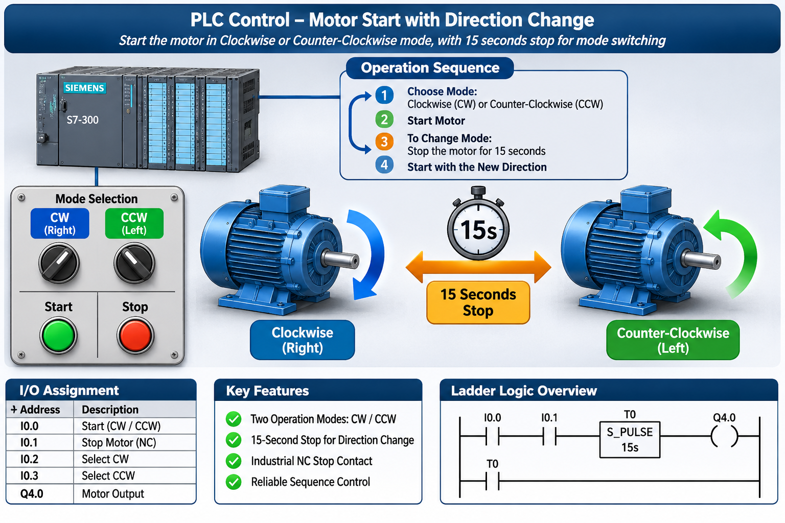
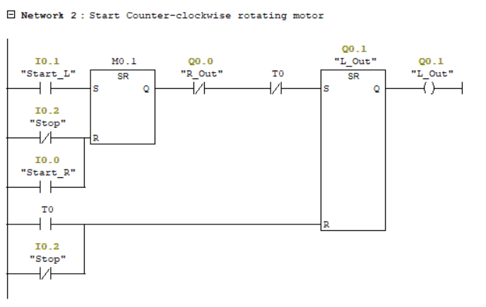
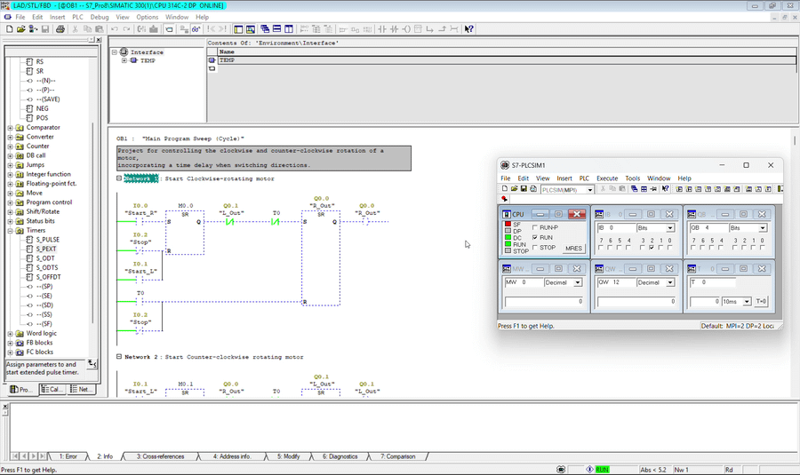

# PLC Motor Direction Control – 15-Second Changeover Delay

## Project Overview

This project implements a motor direction control system using a Siemens S7-300 PLC and Ladder Logic (LAD).

The system allows a motor to operate in either clockwise (right) or counter-clockwise (left) direction. It also includes a 15-second stopping interval when changing the motor's rotation direction.

The control logic is developed using **SIMATIC Manager (STEP 7 V5.7)** and organized into three networks within OB1.

## Process Description

### Clockwise (Right) Operation

1. Activating the right-direction Start command (I0.0) starts the motor in the clockwise direction.
2. Output Q0.0 is activated to control right-direction operation.
3. The motor continues running until a stop or direction-change command is applied.

### Counter-Clockwise (Left) Operation

1. Activating the left-direction Start command (I0.1) starts the motor in the counter-clockwise direction.
2. Output Q0.1 is activated to control left-direction operation.
3. The motor continues running until a stop or direction-change command is applied.

### Direction Changeover Sequence

1. When a change to the opposite direction is requested, the motor stops.
2. A 15-second delay is initiated using timer T0.
3. After the delay, the motor can start operating in the newly selected direction.

This changeover sequence prevents immediate reversal of the motor's rotation direction.

## I/O Assignment

### Digital Inputs

| Address | Description |
| ------- | ----------- |
| I0.0 | Start Right (Clockwise) |
| I0.1 | Start Left (Counter-Clockwise) |
| I0.2 | Stop |

**Important Note:** The Stop pushbutton is designed using a Normally Closed (NC) contact to reflect industrial control wiring practice. Its initial logical input value is set to 1.

### Digital Outputs

| Address | Description |
| ------- | ----------- |
| Q0.0 | Right Rotation Output (R_Out) |
| Q0.1 | Left Rotation Output (L_Out) |

## Timer Configuration

| Timer | Timer Function | Purpose | Preset Time |
| ----- | -------------- | ------- | ----------- |
| T0 | S_PEXT | Direction changeover delay | 15 seconds |

The timer is activated when a request is made to change the motor's rotation direction while the opposite direction output is active.

## Ladder Logic (LAD) Networks

The main PLC control program is organized into three networks within OB1.

- **Network 1:** Start and control of clockwise motor rotation.
- **Network 2:** Start and control of counter-clockwise motor rotation.
- **Network 3:** Timer configuration and 15-second direction changeover delay.

## Program Screenshots

The following screenshots show the Ladder Logic networks implemented in OB1.

### Network 1 – Clockwise Motor Control

### Network 2 – Counter-Clockwise Motor Control

### Network 3 – Direction Changeover Timer

## Simulation Demo

The following GIF demonstrates the motor direction control sequence and the 15-second changeover delay in the simulation environment.

## Software and Hardware

- **PLC:** Siemens S7-300
- **CPU:** CPU 314C-2 DP
- **Programming Software:** SIMATIC Manager – STEP 7 V5.7
- **Programming Language:** Ladder Logic (LAD)
- **Program Block:** OB1
- **Testing Environment:** PLC Simulation

## Project Files

- [PLC Program (PDF)](Documentation/PLC_Program.pdf)
- `Process-Diagram/` – Motor direction control process illustration.
- `Screenshots/` – Ladder Logic network screenshots.
- `GIFs/` – PLC simulation demonstration.

## Learning Objectives

- Implementing motor clockwise and counter-clockwise control using PLC.
- Developing direction selection logic using Ladder Logic.
- Applying timed direction changeover sequences.
- Using Siemens S7-300 PLC timers.
- Implementing stop control with NC input logic.
- Organizing PLC programs into multiple networks.
- Testing motor control sequences through simulation.

## Project Status

Implemented and tested in a simulation environment.

---

*This project is an educational simulation. Practical implementation with a real motor requires appropriate electrical and mechanical interlocking, overload protection, safety circuits, and engineering validation.*
