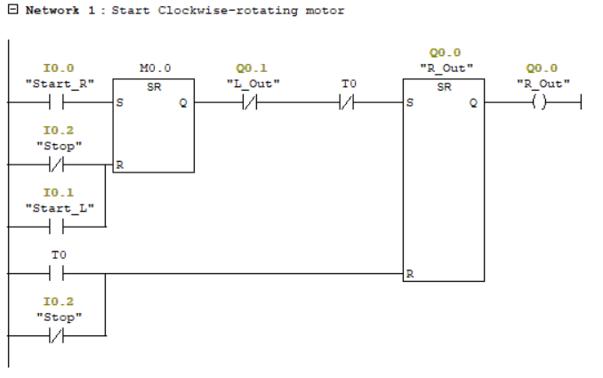
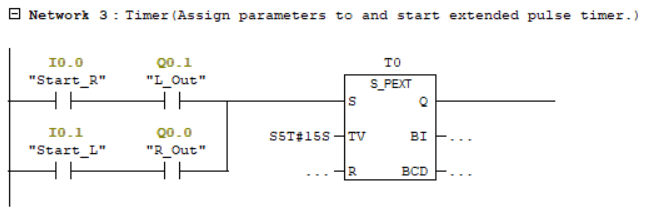

# PLC Motor Direction Control – 15-Second Changeover Delay

## Project Overview

This project demonstrates a motor direction control system implemented using a Siemens S7-300 PLC and Ladder Logic (LAD).

The system controls a motor in two operating directions:
- Clockwise (Right Rotation)
- Counter-Clockwise (Left Rotation)

A 15-second changeover delay is implemented to ensure that the motor stops before switching to the opposite direction.

The PLC program is developed in SIMATIC Manager (STEP 7 V5.7) and organized into three networks within Organization Block OB1.

## Process Description

### 1. Clockwise (Right) Operation

- Activating the Right Start pushbutton (I0.0) requests clockwise motor operation.
- Output Q0.0 (R_Out) controls the right rotation.
- The motor operates in this direction according to the implemented control logic.

### 2. Counter-Clockwise (Left) Operation

- Activating the Left Start pushbutton (I0.1) requests counter-clockwise motor operation.
- Output Q0.1 (L_Out) controls the left rotation.
- The motor operates in this direction according to the implemented control logic.

### 3. Direction Changeover Sequence

When a command to change the motor's rotation direction is received:

1. The currently active direction is stopped.
2. Timer T0 initiates the 15-second changeover delay.
3. After the delay, the requested opposite direction can be activated according to the control logic.

This sequence introduces a stopping interval between opposite rotation commands.

## I/O Assignment

### Digital Inputs

| Address | Symbol | Description |
| ------- | ------ | ----------- |
| I0.0 | Start_R | Start Right (Clockwise) |
| I0.1 | Start_L | Start Left (Counter-Clockwise) |
| I0.2 | Stop | Motor Stop |

**Input Configuration Note:** The Stop pushbutton uses a Normally Closed (NC) contact. Its initial logical input value is set to 1.

### Digital Outputs

| Address | Symbol | Description |
| ------- | ------ | ----------- |
| Q0.0 | R_Out | Right Rotation Output |
| Q0.1 | L_Out | Left Rotation Output |

## Timer Configuration

| Timer | Timer Function | Purpose | Preset Time |
| ----- | -------------- | ------- | ----------- |
| T0 | S_PEXT | Direction Changeover Delay | 15 seconds |

Timer T0 is configured using the S_PEXT timer function with a preset time of S5T#15S.

It is used in the direction changeover logic to provide the required stopping interval before the opposite direction is activated.

## Control Program Structure

The main PLC program is implemented in OB1 and consists of three Ladder Logic networks.

| Network | Function |
| ------- | -------- |
| Network 1 | Clockwise motor control |
| Network 2 | Counter-clockwise motor control |
| Network 3 | Timer configuration and direction changeover delay |

## Program Screenshots

The following screenshots illustrate the Ladder Logic implementation in SIMATIC Manager.

### Network 1 – Clockwise Motor Control

### Network 2 – Counter-Clockwise Motor Control

### Network 3 – Direction Changeover Timer

## Simulation Demo

The following GIF demonstrates the motor direction control operation and the 15-second changeover delay in the simulation environment.

## Test Scenarios

The following operating scenarios are used to evaluate the control logic in the simulation environment.

| Test | Operating Scenario | Expected Behavior |
| ---- | ------------------ | ----------------- |
| 1 | Right Start command (I0.0) | Right rotation is requested |
| 2 | Left Start command (I0.1) | Left rotation is requested |
| 3 | Direction change request | A 15-second changeover interval is applied |
| 4 | Stop command (I0.2) | Motor stop control is activated |

All test scenarios were evaluated in the PLC simulation environment.

## Software and Hardware

- **PLC:** Siemens S7-300
- **CPU:** CPU 314C-2 DP
- **Programming Software:** SIMATIC Manager – STEP 7 V5.7
- **Programming Language:** Ladder Logic (LAD)
- **Program Block:** OB1
- **Timer:** T0 – S_PEXT
- **Testing Environment:** PLC Simulation

## Project Files

- `README.md` – Project overview and technical documentation.
- `Documentation/PLC_Program.pdf` – PLC program documentation.
- `Process-Diagram/` – Motor direction control process diagram.
- `Screenshots/` – Ladder Logic network screenshots.
- `GIFs/` – PLC simulation demonstration.

## Learning Objectives

- Implementing bidirectional motor control using a Siemens S7-300 PLC.
- Developing clockwise and counter-clockwise control logic.
- Applying timed direction changeover sequences.
- Configuring PLC timers using STEP 7.
- Understanding NC pushbutton input logic.
- Organizing PLC programs into multiple Ladder Logic networks.
- Testing control sequences through PLC simulation.

## Project Status

**Status:** Completed and tested in a simulation environment.

The project demonstrates the implementation of bidirectional motor control with a timed direction changeover sequence using Siemens S7-300 PLC technology.

---

*Disclaimer: This project is developed for educational and simulation purposes. Practical implementation with a real motor requires appropriate electrical and mechanical interlocking, overload protection, emergency stop circuits, and proper engineering validation.*
